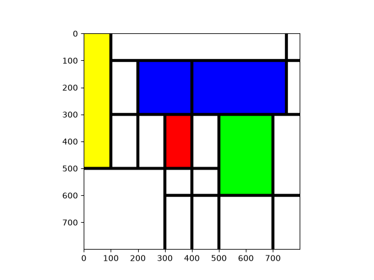

Tarea 1: Ajedrez

My implementation: I simply started with a black 800x800 board and used a nested loop to go line by line, column by column for a total of 64 times to paint the right boxes. 

Ai implementation: 
my prompt: In Ajedrez_ai.py make a 800x800 px chess board and show it on screen
Ai didn't use matplotlib but the idea to paint the boxes is the same. As usual Ai builds a function and a main for even the smallest projects.

Tarea 2: Mondrian

I initially thought of making a generator that uses a pnrg to make infinite random mondrian images.
While I could do that, it was not exactly what was requsted and it would have taken way more time, that's why I settled for a "hand-made" mondrian.
What I did was put together some random rectangles with a polarized rgb like mondrian paintings, then I put together all the lines.
To make it better I would add a colored rectangle in the bottom left part.

Tarea 3:Circulos

I picked the obvious decision to use a nested loop to find the lowest and highest mean of rgb values, and so the darkest and clearest. The video isn't fluid because of the time python needs to run the loops. 
Can it be made faster/more fluid?
An obvious way would be to use a lower level language like C or C++ reusing the exact same implementation. A smarter approach could imply converting the image to a binary(black/white) color palette before the mean, but that may cost even more. I see no other possibly more efficient way, unless the np library has some efficient way to look for the darkest and clearest.

Tarea 4:Propuesta de Pop Art
Using the webcam input it could be possible to make a pop art looking image in the famous Marilyn Monroe from Andy Warhol style. Many versions could be made as in the original by joining together a selected range of pixel and changing them, and possibly an area around them, with some kind of bright color. 

[Marilyn Monroe - Andy Warhol](https://www.moma.org/collection/works/61240)
[Pop_Art](https://en.wikipedia.org/wiki/Pop_art)