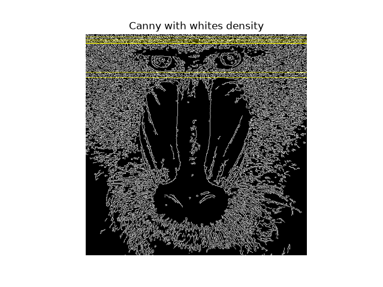
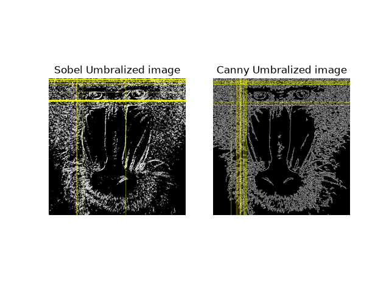

Primera tarea: Blanco_count.py
The image was turned from BGR to black and white, then it was polarized by canny and reduced to an array with the sum of row pixels value with reduce. The most white row was found and so the one with at least 0.9 whiteness as the main row. The indices were then used to highlight the rows in the image.

Segunda tarea: SobelUmbra.py
It reused the previously written code and turned it into a func code as it was needed both for sobel and for canny image. The sobel image is shown, following the exact same process of Blanco_count, but with the application extended to columns too. Then the canny image is shown the same way and in the end both are shown for comparison on screen

Tercera tarea:Pong
To do pong and make it movable by camera I copied the concept of "A little piece of privacy" and applied it to the pong game. The code was copied from an old python implemantation and modified to use video movement instead of keyboard controls.
START OF CHANGES and END OF CHANGES serve to show the part of the code which was modified.
