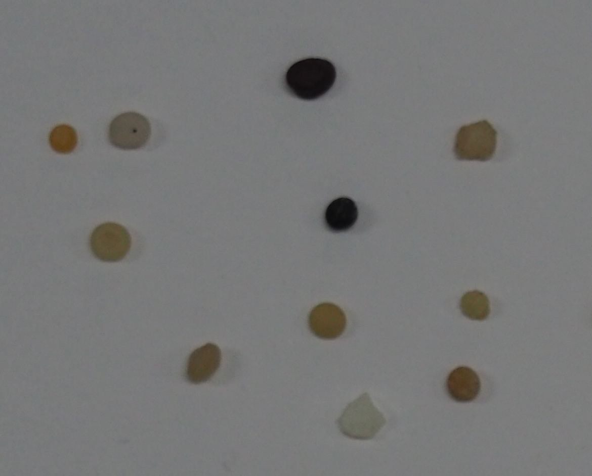

Tarea1-MoneyRecon

The first tarea objective was to create a program able to count the value of the coins(euros) shown in the camera capture. 
The first file was a  used to understand if the idea worked on paper. The  contains the concept of the first one but it's polished and contain the camera implementation.
The idea is simple, the user has to first select two coins in the image, the one euro and the cent. This will allow the program to calibrate itself on the camera environment. After the coins are selected, informations are extracted to regulate parameters relatives to color and size. The color is picked first and the size is secondary, a difference is also made between high value coins(1 and 2 euro) and the rest since the high value possess a different color ring.
The coins are classified in 3 classes: ring, golden and bronze. From there the rest is decided based on the size. A weakness of this model could be made in the color selection, for which weird lighting could create false assignement to classes. Another weakness could be the circle lookup that doesn't look for slightly sideways circles that would give problems to the color classification(while keeping mostly corrct the size classification of minor importance).
A possible solution could be doing the circle and then use an ellipse or similar geometric form to get the correct segmentation of not frontal coin, the process to classify the values could then be the same, even if harder because of light reflection and hard to classify coin rings

Tarea2-Plastic
Two files compose this homework:  and .
Here the objective was to use the three images to identify the differences between the 3 types of plastic to then be able to recognise them in a image. 
The means used to find differences were brightness and roundness of the elements, color was also taken into account but was then seen as not useful compared to the other after looking at the images. The images were analyzed to look for what kind of thing to look. The  has light element with sharp borders, the  has all round element, mostly light colored and the only dark are very round. The third image is with sharp borders and dark coloring.
My idea was to put dark elements in the third category, the light round or dark but round in the second and sharp in the first category. An algorithm is used to decide what brightness and roundness threshold use to decide if something is "round" or "not round" and "bright" or "not bright".
The algorithm manage to find threshold to divide correctly the elements with 27/29 correctness which seems good enough and yet for the real case the correctness is way lower. The cause of this it's the background which differ a lot from the images the algorithm was built on. It is in fact in range (230,230,230) instead of (125,125,125) range. 
A possible solution would be to just set the algorithm to do a difference between the elemnt and the sorrounding background, this would solve the light problem as in the test image the values are changing. This makes the algorthm good only in same lightning and uniformity images as in the 3 that were used for parameter adjustement.

The training results with ajusted parameters:

The result on the confusion matrix:

Result shown on image:
